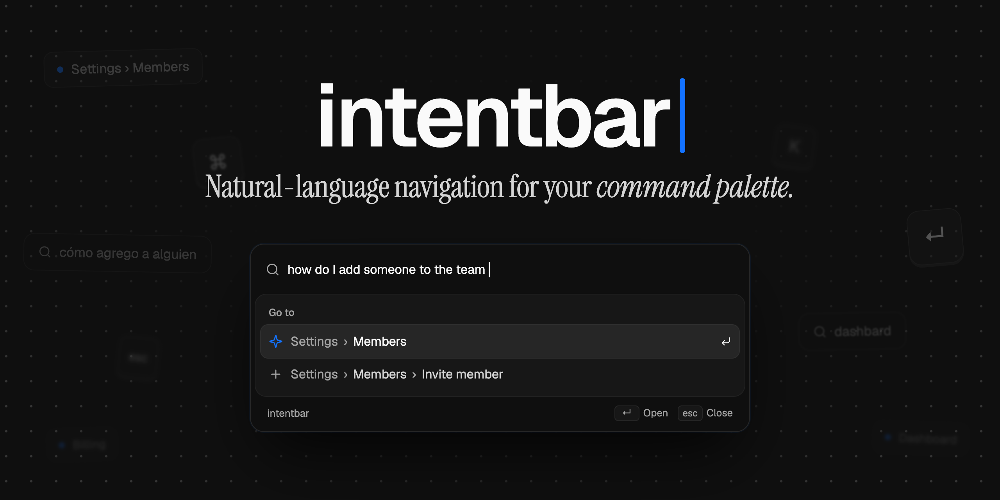

# intentbar

Natural-language navigation for your command palette. The user types what they
want, in any language, and lands on the right page.

- Zero dependencies. One `fetch`; the React hook is optional.
- The model picks an id from your route list. It never writes a URL.
- Exact matches in `intents` skip the model: 0 ms, no request.

## How it works

1. **Sitemap** — your read-only destinations: id, path, breadcrumb, a
   description of what the page is for, and the phrases users type for it.
2. **Endpoint** — the query goes to your server, which calls [OpenAI's Decisions
   API](https://developers.openai.com/api/docs/guides/decisions). The API key
   stays server-side.
3. **Palette row** — the hook returns the match, Enter navigates.

The model either picks an id from the sitemap or abstains. Ids that are not in
the sitemap are rejected, and anything below the confidence threshold (0.72)
leaves the user where they are.

All three as code: [docs/wiring.md](docs/wiring.md).

## Install

The repo is an agent skill, so the instructions and the code ship together.

```bash
npx skills add enesozturk/intentbar
```

Works with any agent that reads skills — Claude Code, Codex, Cursor, OpenCode.
Listed on [skills.sh](https://www.skills.sh/enesozturk/intentbar).

Then run the skill:

```
/intentbar-setup
```

It reads your router, copies the code in (plain TypeScript, no build step),
writes the sitemap from your pages, mounts the endpoint, wires your palette or
adds a shadcn one, and tests the result against the live API.

The sitemap has to come from the app, not from a list of route paths: the
descriptions and `intents` are what the model reads. That is the reason this is
a skill and not a copy command.

To update: `npx skills update intentbar-setup`, then copy again.

## Examples

Measured on an 8-destination English sitemap — Dashboard, Orders, Products,
Assistant, and Settings › Billing / Members / API tokens / Profile:

| typed | row shown | |
| --- | --- | --- |
| `invoices` | Settings › Billing | exact hit, no request |
| `add someone to my workspace` | Settings › Members | 0.99 |
| `create an api key` | Settings › API tokens | 0.99 |
| `cómo agrego a alguien al equipo` | Settings › Members | 0.98 |
| `dashbard` | Dashboard | 0.92 |
| `why did my revenue drop last week` | Ask the assistant | 1.00 |
| `how did last week go` | Ask the assistant, Dashboard below it | 0.97 / 0.73 |
| `asdfgh qwerty` | nothing | abstains |

Typos and other languages resolve without extra work: the model reads intent,
not strings, so the sitemap does not need translating. Questions get an
assistant row instead of "no results" — that check rides along in the same
request.

## Cost

One request per phrase, 0.2–0.5s. Input tokens only, and no caching discount,
so every lookup bills the whole sitemap.

| sitemap | per 1,000 lookups |
| --- | --- |
| 25 lean destinations | $0.11 |
| 25 with two-language intents and both questions | $0.18 |

Exact `intents` hits are free. The two levers are a short sitemap and a full
intents list; the skill does both by default.

## More

- [docs/wiring.md](docs/wiring.md) — the sitemap, the endpoint, the palette and
  the fallback row, as code.
- [docs/reference.md](docs/reference.md) — options and guarantees.
- [docs/multi-tenant.md](docs/multi-tenant.md) — resolving "acme billing" inside
  the workspace the user belongs to.

## Status

Experimental. Not on npm: no releases, no semver, update with `npx skills
update`. The Decisions API is in public beta and serves one model
(`gpt-6-luna`); `src/core/providers/decisions.ts` is the only file that depends
on it.

MIT
